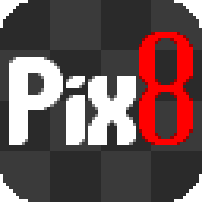
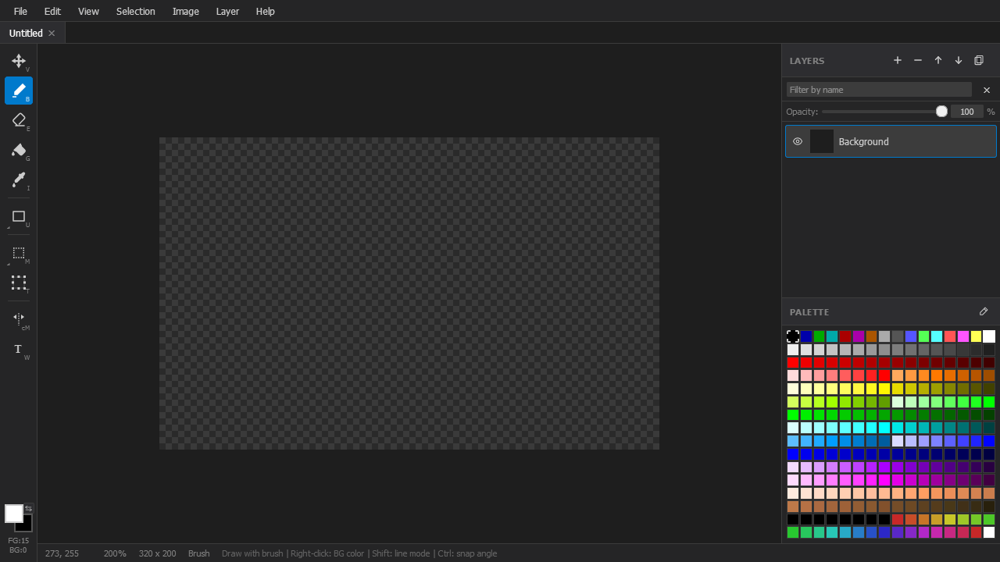

  

<h1 align="center">Pix8</h1>

A 256-color pixel art editor inspired by VGA-era graphics tools. It runs in the browser and as a desktop app.

Try it online: <a href="https://pix8.app">pix8.app</a>

## Get it

**In the browser** — open [pix8.app](https://pix8.app). Nothing to install.

**Windows** — [**Installer** (`Pix8.Setup.1.9.0.exe`)](https://github.com/DynartInteractive/Pix8/releases/download/v1.9.0/Pix8.Setup.1.9.0.exe) · [**Portable** (`Pix8.1.9.0.exe`)](https://github.com/DynartInteractive/Pix8/releases/download/v1.9.0/Pix8.1.9.0.exe)

The installer lets you pick the install directory and adds a desktop shortcut; the portable is a single file — run it, no install. Both are **unsigned** for now, so SmartScreen warns on first run (*More info → Run anyway*).

**Linux / macOS / Android** — no prebuilt downloads yet; use the browser version, or [build it from source](docs/building.md).

Older versions are on the [releases page](https://github.com/DynartInteractive/Pix8/releases).

## What it does

- **One palette of 256 colors** per picture, as on a VGA card. Change a color in the palette and every pixel that uses it changes with it. New pictures start with Deluxe Paint II's palette.
- **A palette editor in the style of GrafX2** — color ranges, ramps (Spread), sorting, merging, swapping, and a 6-bit VGA mode.
- **Drawing tools** — brush, eraser, straight lines, rectangles, ellipses, flood fill, text, and custom brushes cut from a selection, each with an exact preview before you commit.
- **Layers** with their own size and position, opacity, and a name filter for long lists.
- **Selections** — rectangle and ellipse, add and subtract, move, mirror, and Free Transform (resize and rotate).
- **Animation** — a frame timeline with tags, playback, onion skinning, and linked frames that share one image.
- **Grid, rulers and guides** with snapping, and zoom up to 32x with sharp pixels.
- **Several pictures open in tabs**, with copy and paste between them that matches colors to the target palette.
- **Opens ordinary images** (PNG, JPG, GIF, WebP) and reduces them to 256 colors, with optional dithering.
- **Exports** PNG, GIF (still or animated), BMP, PCX, Windows icons (ICO), and sprite sheets.

The complete list is in [docs/features.md](docs/features.md).

## File formats

| Format | Open | Save / export |
|--------|------|---------------|
| .pix8 (Pix8's own: layers, animation, palette) | Yes | Yes |
| PNG | Yes | Yes |
| BMP, PCX (8-bit) | Yes | Yes |
| JPG, WebP | Yes | -- |
| GIF | Yes | Yes, also animated |
| ICO (Windows icon) | -- | Yes |
| SPX (sprite sheets) | -- | Yes |
| PAL (palette) | Yes | Yes |

## Shortcuts to start with

| Key | Action |
|-----|--------|
| B / E | Brush / Eraser |
| I | Color Picker |
| G | Flood Fill |
| M | Rectangle Select |
| V | Move |
| T | Free Transform |
| X | Swap foreground and background colors |
| +/- | Zoom in / out |
| Middle mouse drag | Pan the canvas |
| Shift (brush) | Straight line from the last pixel |
| Ctrl+Z / Ctrl+Shift+Z | Undo / Redo |
| Ctrl+S | Save project |
| Ctrl+Shift+E | Export as... |

All of them are in [docs/shortcuts.md](docs/shortcuts.md).

## More

| | |
|---|---|
| [Features](docs/features.md) | Everything the editor can do, in detail |
| [Keyboard shortcuts](docs/shortcuts.md) | The full list |
| [Known issues](docs/known-issues.md) | Two display and desktop problems, with workarounds |
| [Future improvements](docs/future-improvements.md) | What is planned, and why |
| [Changelog](CHANGELOG.md) | What changed in each version |
| [Building from source](docs/building.md) | Web version, desktop app (Electron), Android app |
| [How it works](docs/how-it-works.md) | Project structure, technical notes, algorithms |
| [Releasing](docs/releasing.md) | The steps for a new version |

## License

Pix8 is released under the [MIT license](LICENSE).
