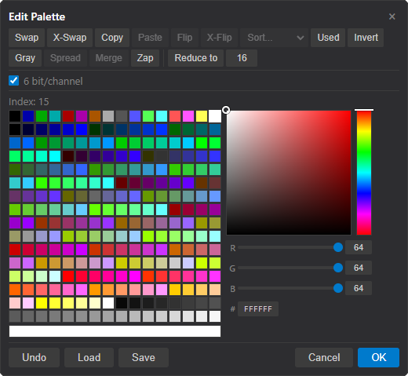

# Features

The full list. The [README](../README.md) has the short version.

## Palette

- **256-color indexed palette** -- all 256 entries (0-255) are usable colors, transparency is a separate sentinel value. New documents start with Deluxe Paint II's default palette; `palettes/` holds it and the previous default as loadable `.PAL` files
- **GrafX2-style palette editor** -- double-click a swatch (or the edit button) to open it on that colour; range selection, HSV color picker (saturation/value square + hue strip), RGB sliders with hex input, batch operations (Swap, X-Swap, Copy, Flip, X-Flip, Neg, Gray, Spread, Merge, Sort, Reduce, Zap Unused, Used highlight), 6-bit VGA mode, palette Load/Save (PAL/BMP/PCX)

## Canvas and view

- **Photoshop-like layout** -- toolbar with flyout groups on the left, canvas in the center, layers and palette on the right
- **Pixel-perfect zoom** -- nearest-neighbor interpolation at all zoom levels (1x-32x), pixel grid overlay at 12x+
- **Configurable grid** -- user-settable grid size with snap-to-grid support (View > Grid Settings)
- **Rulers and guides** -- pixel rulers along canvas edges; drag from ruler to create custom guide lines with snap support
- **Multi-document tabs** -- independent documents with separate layers, palette, undo history, and zoom/pan state
- **Desktop-style menus** -- click to open, hover to switch, same for toolbar flyout groups
- **Toast notifications** -- non-blocking slide-down messages replace browser alert dialogs

## Layers

- **Independent layers** -- each layer has its own size and position, auto-extends when drawing outside bounds
- **Fixed-size layers** -- lock a layer to exact dimensions via Layer > Set Fixed Size, preventing auto-extend; used for ICO export workflow
- **Layer operations** -- add, delete, reorder, duplicate, toggle visibility, solo, rename, opacity (0-100%), trim to content, crop to canvas, set/remove fixed size, show border
- **Layer name filter** -- narrow a long layer list by name as you type, with a match count; the active layer stays visible even when it doesn't match

## Drawing

- **Drawing tools** -- Brush, Eraser, Color Picker, Rectangle, Filled Rectangle, Ellipse, Filled Ellipse, Flood Fill
- **Brush/Eraser line mode** -- hold Shift to draw a straight line from the last pixel you drew, previewed live before you click (GIMP-style); each line re-anchors at its end so segments chain. Ctrl snaps angles to 22.5-degree increments
- **Brush right-click** -- draw with background color using right mouse button
- **Pixel-perfect preview** -- all drawing tools show an 80% opacity preview of the exact pixels before committing
- **Text tool** -- create text layers with configurable font, size, bold/italic/underline, anti-aliased palette-mapped rendering, and palette color picker (W shortcut)

## Selecting and moving

- **Move tool** -- reposition layers and floating selections; snaps layer content edges to grid lines and guides
- **Mirror tool** -- flip image or selection horizontally (click) or vertically (Shift+click)
- **Selection tools** -- Rectangle and Ellipse selection with resizable handles, edge-based boundaries that snap to grid/guides
- **Selection modifiers** -- Ctrl+drag to add, Alt+drag to subtract, Shift for proportional (square/circle); Selection menu: Select All, Deselect, Expand, Shrink, Select by Alpha
- **Free Transform** -- move, resize, and rotate selected pixels with interactive handles (T shortcut), Ctrl snaps rotation to 22.5-degree increments
- **Clipboard** -- Cut, Copy, Copy Merged, Paste, Paste in Place, Paste as New Layer; Paste lands on the current layer as a floating selection you can drag with the Move tool and drop by deselecting; copies are clipped to the source layer, so Select All on a small layer in a large document yields the layer, not the canvas; automatic palette color remapping between documents; system clipboard paste with dithering
- **Undo/Redo** -- Ctrl+Z / Ctrl+Shift+Z, 50-step history including palette edits, all layer operations (add, delete, move, duplicate, rename, visibility, opacity), frame operations (add, delete, move, edit), and paste/import

## Animation

- **Frame animation** -- sprite-sheet animation with per-frame pixel data; frame timeline with thumbnails, tag groups, play/pause/stop, tag-based playback; GIF and SPX export also available for still (non-animated) images
- **Linked cels** -- share one image between frames per layer (Aseprite-style): editing any linked frame updates them all, and a linked frame costs no extra space in the `.pix8` file. Shift+click the timeline to select a range, then Link/Unlink; the bar under the thumbnails shows runs for the **active layer**
- **Onion skinning** -- red-tinted previous frames, blue-tinted next frames; configurable opacity; extended mode (+-2 frames)

## Import and export

- **Unified export dialog** -- single "Export as..." dialog (Ctrl+Shift+E) with format selector (BMP, PCX, PNG, PNG layers, PNG frames, GIF, SPX, ICO) and format-specific options
- **PNG frames export** -- one PNG per animation frame in a zip, named `<basename>_<tag>_<n>.png` (the `_<n>` dropped when a tag holds a single frame), ready for texture packing
- **Truecolor image import** -- File > Open supports PNG/JPG/GIF/WebP with median-cut quantization and dithering (None/Floyd-Steinberg/Ordered Bayer)
- **Command line** -- `pix8 export:frames <file.pix8> <folder>` writes the same frames as loose PNGs for a texture-packing pipeline; `--clean` clears frames a renamed tag left behind

### File formats

| Format | Import | Export | Notes |
|--------|--------|--------|-------|
| .pix8 | Yes | Yes | Native project format (layers, animation, palette) |
| BMP | Yes | Yes | 8-bit indexed color |
| PCX | Yes | Yes | 8-bit indexed color with RLE compression |
| PNG | Yes | Yes | Truecolor import with quantization, indexed export |
| JPG/GIF/WebP | Yes | -- | Truecolor import with quantization |
| GIF | -- | Yes | GIF89a with LZW compression, transparency, still or animated |
| SPX | -- | Yes | Sprite XML + PCX sprite sheet(s) as ZIP |
| ICO | -- | Yes | Windows icon with multiple sizes from fixed-size layers |
| PAL | Yes | Yes | 6-bit raw binary or 8-bit JASC-PAL text |
